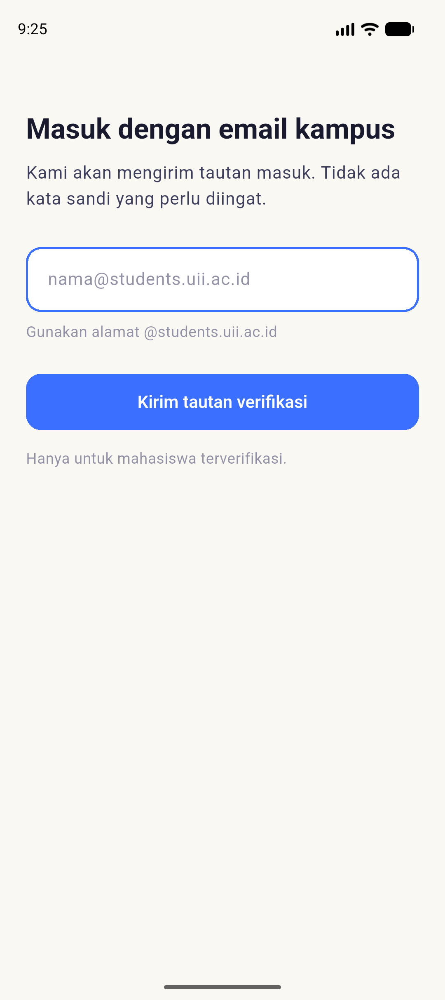
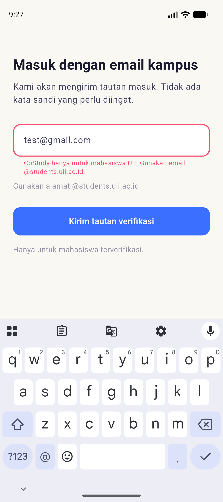
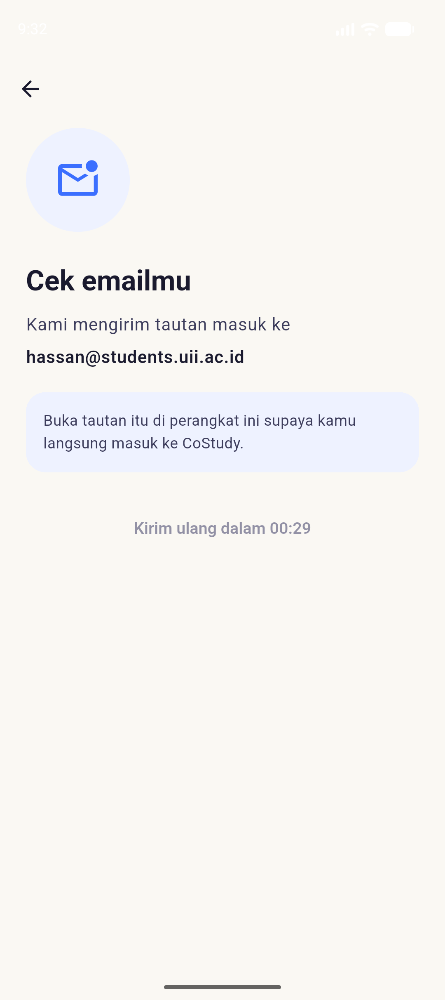

# CoStudy

**Nobody studies alone because coordination failed.**

An Android app that forms in-person study sessions from students' overlapping
study intentions — without anyone having to ask first.

Built for **GEMASTIK XIX 2026** (Software Development) by team **QuantaLabs**,
Universitas Islam Indonesia, Yogyakarta.

---

## The problem

Students want to study together and routinely fail to. Not from lack of
interest — from an **assurance game**. Everyone prefers the study-together
outcome, but will only commit if confident others will too. Without that
assurance, everyone picks the safe strategy and studies alone, even though
that outcome is worse for all of them.

Three barriers follow:

| Barrier | What happens |
|---|---|
| **Cold start** | Whoever posts to an empty board bears all the social risk. If nobody comes, they look rejected. So nobody posts. |
| **Invisible intent** | Two students 200 m apart, both free at 7 PM, have no channel to discover each other. The information exists but is never revealed. |
| **One-sided commitment** | Someone commits first with no guarantee the other shows up. No-shows destroy trust and end usage. |

Every comparable product — study-buddy apps, class group chats — requires
someone to **announce first** and absorb the risk of no response. None of them
solves this structurally.

## The mechanism

CoStudy applies an **assurance contract**, the same structure that makes
all-or-nothing crowdfunding work: your pledge is void unless the threshold is
reached.

> Users do not announce sessions. They register an availability window that
> stays **private**. The system holds these intentions, searches for overlaps,
> and only materialises a session once a minimum participant threshold is met —
> at which point everyone is notified **simultaneously**.

Two consequences shape the entire codebase:

- **No user is ever first on an empty board.** Nothing is visible until a
  session already exists.
- **No rejection is ever shown.** An intent that matches nobody expires in
  silence. The student is never told they were passed over, because being
  passed over is the experience this product exists to remove.

## Screenshots

| Sign in | Domain rejected | Check inbox |
|---|---|---|
|  |  |  |

Captured on a Pixel 9 emulator (API 37). Interface copy is Indonesian.

## How it works

```
Flutter app (Android)
      │
      ├── Firebase Auth ──────── email-link sign-in, restricted to
      │                          @students.uii.ac.id by a blocking function
      │
      ├── Cloud Firestore ────── users · intents · coalitions · coalitionMembers
      │                          privacy enforced by security rules, not by the UI
      │
      ├── Cloud Functions ────── runCoalitionMatcher      (every 5 minutes)
      │                          completeCoalitionOnConfirm (Firestore trigger)
      │                          enforceCampusDomain×2      (auth blocking)
      │
      └── Cloud Messaging ────── one simultaneous multicast per formed session
```

### The coalition engine

The matching algorithm lives in
[`functions/src/coalitionEngine.js`](functions/src/coalitionEngine.js) as a
**pure, dependency-free module** — no Firebase, no I/O, no clock reads. It is a
deterministic transformation of plain objects, which is what makes it testable
in isolation and keeps the domain vocabulary out of the algorithm.

Its objective function is deliberately **sessions that complete**, not pairs
formed. A match 3 km away at 6 AM is both a "match" and a failure. Constraints:

- pairwise time overlap ≥ 60 minutes (the shortest session worth travelling for)
- a meeting point inside **every** member's own travel radius
- atmosphere compatible — `hening` / `diskusi` are mutually exclusive, `bebas` matches both
- group size within `[2, 5]`
- one coalition per user per overlapping time range

Greedy first-fit, `O(k log k)` sort + `O(k·g)` placement. A benchmark
(`npm run bench`) measures the non-functional requirement of < 3 s for 500
intents across three distributions:

| Distribution | Median | Coalitions |
|---|---|---|
| clustered (the pilot scenario) | **1.3 ms** | 100 |
| scattered (city-wide) | **6.4 ms** | 165 |
| pathological (no pair can ever group) | **15.1 ms** | 0 |

The pathological case is a lattice engineered so `g` reaches `k`, giving the
true `O(k²)` upper bound — measured at ~3.6× per doubling. Roughly 2,300×
inside budget at pilot scale.

### Privacy is enforced by the database

The assurance contract only works if nobody can observe who else is waiting.
That is a **security-rules** property, not a UI one:

- An intent is readable only by its owner. Firestore evaluates `list` against
  the *query*, so an unfiltered read of `/intents` is refused outright — a
  student cannot enumerate the collection even to count it.
- No `match /{path=**}/intents/{id}` rule exists, so collection-group queries
  find no way in either.
- Clients may only ever create an intent as `aktif` and update it to
  `dibatalkan`. Advancing to `tercocokkan` belongs to the matcher, via the
  Admin SDK, which bypasses rules.
- A coalition is readable only by its members, proven by an `exists()` lookup
  on a deterministic member-document id.
- **Member names are never shown.** A session displays a count and faculty
  labels only. Those labels are resolved *server-side* and denormalised onto
  the coalition, because rules refuse both roster listing and reads of other
  students' profiles — so the client has no path to the people behind them.
  Duplicate faculties collapse, so the list cannot be counted off against the
  member count.
- **Raw coordinates never reach a user.** The meeting point is reverse-geocoded;
  every failure path returns a place description, never numbers.

## Tests

| Suite | Count | Command |
|---|---|---|
| Flutter widget + unit | 69 | `flutter test` |
| Node unit (engine, matcher, mapper, auth) | 103 | `npm test --prefix functions` |
| Firestore security rules (emulator) | 57 | `npm run test:rules --prefix functions` |
| End-to-end server chain (emulator) | 6 | `npm run test:e2e --prefix functions` |

The rules suite pairs every denial with a positive control — a suite made only
of "this is denied" assertions passes just as happily against rules that deny
everything. It has been mutation-checked: loosening a single `allow get` fails
exactly one test.

The end-to-end suite drives the **real Admin SDK against a real Firestore**
(emulated) through the whole chain: intents → coalition → notification →
confirmation → completion, plus silent expiry and no-rematch across runs.

## Repository layout

```
lib/
  auth/          email-link sign-in, campus domain validation
  intent/        availability windows, location, Firestore writes
  coalition/     sessions, membership, place-name resolution
  profile/       student profile + faculty vocabulary
  notifications/ FCM token lifecycle
  screens/       UI, one file per screen
  theme/         design tokens ported from Figma
  widgets/       mascot, shared components

functions/
  src/           coalitionEngine · matchAndNotify · completeCoalition
                 intentMapper · authBlocking
  test/          unit, rules (emulator), e2e (emulator)
  bench/         NFR-02 performance benchmark

firestore.rules  the privacy guarantee, in enforceable form
```

## Running it

```bash
flutter pub get
npm install --prefix functions

flutter run                              # needs android/app/google-services.json
npm test --prefix functions              # fast, no emulator
npm run test:rules --prefix functions    # starts the Firestore emulator
npm run test:e2e --prefix functions      # starts the Firestore emulator
```

## Project status

Honest accounting, because a demo that overstates itself fails under questions:

**Working and verified**
- Email-link sign-in, campus domain restriction, Android App Links verification
- Intent registration writing to Firestore under the rules above
- Navigation shell, session detail, attendance confirmation, history
- The matcher and completion trigger, proven end to end against the emulator
- Firestore rules — **deployed**

**Built but not yet running in production**
- Cloud Functions are **not deployed**: the project is on the Firebase Spark
  plan and v2 functions require Blaze. The matcher has therefore never run
  against the live database, so `coalitions` has no writer there yet.
- No real FCM notification has been sent or received end to end.

**Out of scope by design** (see the proposal) — in-app chat, payments, no-show
prediction, activity heatmaps, browsing other users' profiles. That last one is
not a missing feature: a browsable profile list would reintroduce the
first-initiative risk the whole system exists to remove.

## Team

| | |
|---|---|
| Hassan Waleed Hassan Abdo Al-Awadhi | System architecture, coalition engine |
| Nada Taufik Shahbal | Flutter frontend, interface design, usability testing |
| Laraib Arshad | Firebase backend, geospatial integration, testing |

## Licence

[MIT](LICENSE) — chosen so a later cohort can pick this up and continue it,
which the project plan commits to.

Bundled fonts (Plus Jakarta Sans, DM Mono) are SIL Open Font License; their
licences are in [`assets/fonts/`](assets/fonts/).
